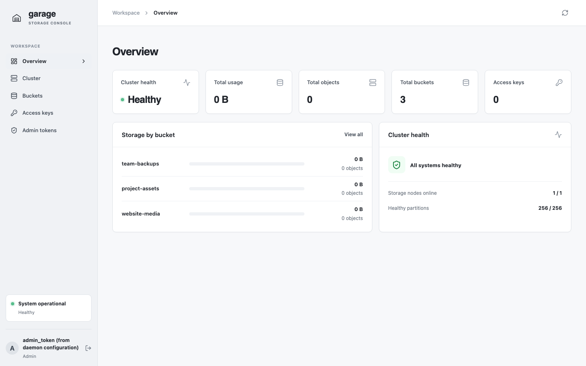
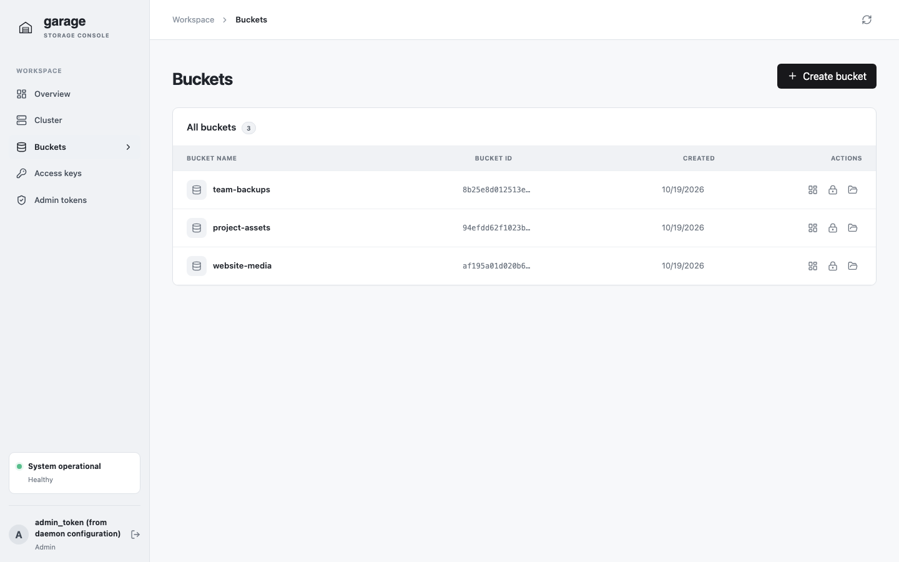
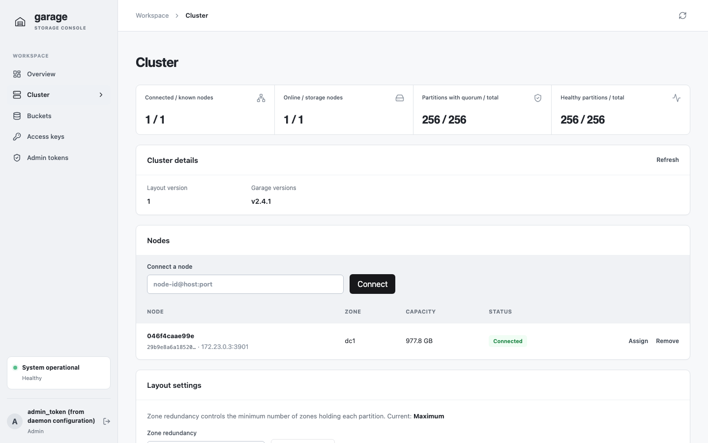

# Garage Web UI

Garage Web UI is a web interface for managing [Garage](https://garagehq.deuxfleurs.fr/) buckets, access keys, admin tokens, and objects.

## Screenshots

The overview brings cluster health and storage usage together.



Manage buckets and their permissions from the bucket list.



Inspect nodes and cluster layout settings on the cluster page.



## Quick start

With Docker Compose, Go, and npm installed, run the local development stack from the repository root:

```sh
make run
```

Open [http://localhost:8080](http://localhost:8080) and sign in using admin token `local-garage-admin-token`. The development stack uses local-only credentials and is not a production deployment.

## Documentation

- [Configuration](configuration/index.md) — flags, environment variables, authentication, and object uploads.
- [Authentication](authentication/index.md) — Garage admin tokens and bucket-scoped S3 credentials.
- [Deployment](deployment/index.md) — run the local stack and understand production prerequisites.
- [Development](development/index.md) — build, test, format, and work on this site.
